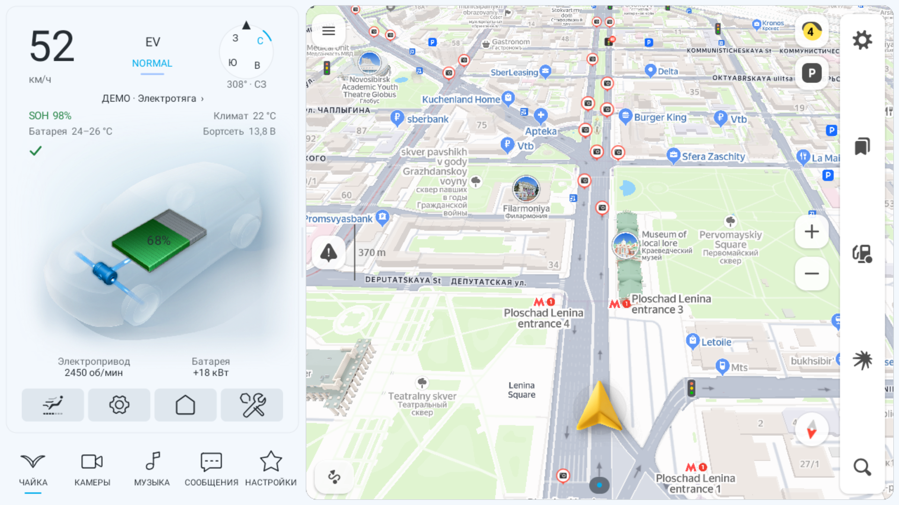
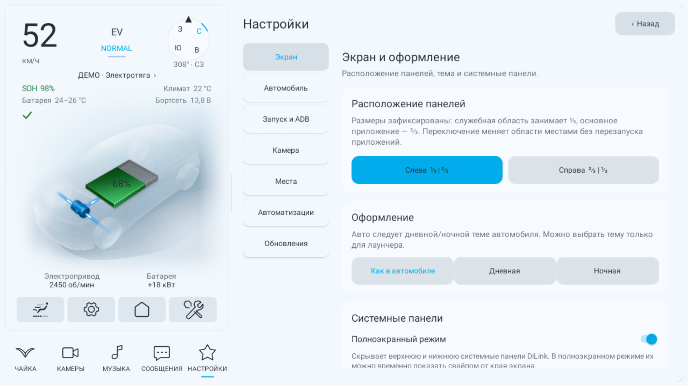
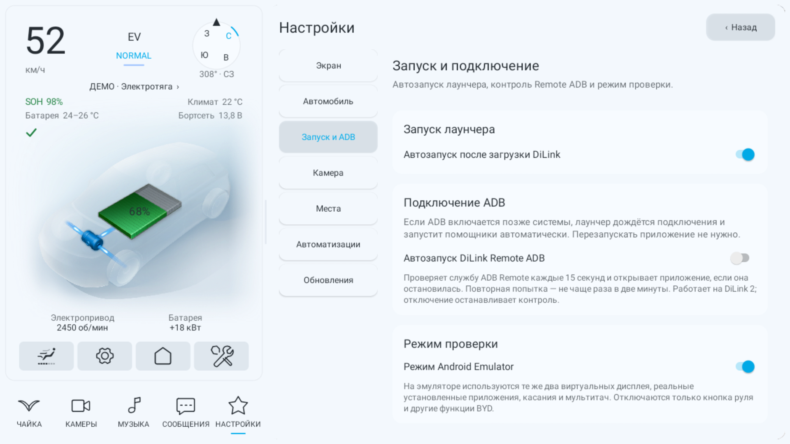

# BYD Split · Seagull

Лаунчер для **BYD Seagull («Чайка») с DiLink 2 и Android 9**.
Состояние электромобиля, навигация и любимые приложения — на одном экране.

[Скачать APK · 0.9.2-alpha.9](https://github.com/hix83/BYD-Split/releases/tag/seagull-v0.9.2-alpha.9)
· [Что нового](docs/releases/seagull-v0.9.2-alpha.9.md)
· [Сообщить о проблеме](https://github.com/hix83/BYD-Split/issues)

**Обновление:** с alpha.5 и новее — поверх, с сохранением настроек.
У alpha.4 другой ключ подписи: перед переустановкой потребуется перенос
настроек. Удаление приложения удаляет его данные.

**Предварительный выпуск.** Работа проверяется на Seagull со штатным экраном
10,1″, 1280×720. На реальном DiLink 2 подтверждены телеметрия и работа
встроенного Навигатора; длительные проверки в поездке и после перезагрузки
продолжаются.

*Скриншоты текущей ветки сделаны в эмуляторе: показания автомобиля
демонстрационные, точка на карте тестовая. Индикатор ADB и обновлённые
настройки входят в alpha.5.*

## Всё нужное рядом

**Две области 1:2.** В компактной области — автомобиль или музыка,
в основной — навигация, мессенджер или другое установленное приложение.
Области можно поменять местами. Поддерживаются касания, свайпы и мультитач;
выбранные приложения сохраняются между запусками.

**Панель электромобиля.** Изометрическая схема Seagull, заряд батареи,
электропривод и потоки энергии. Скорость, направление движения, SOH,
температура батареи, напряжение бортсети и целевая температура климата.
Двигателя внутреннего сгорания, топливного бака и гибридных показателей нет.
Недоступные данные отображаются прочерками.

**Батарея и техника.** Нажатие на SOH открывает состояние батареи,
кнопка с инструментами — технические показатели. Страницы занимают основную
область, сохраняя панель автомобиля рядом. На проверенной машине доступны графики
напряжений 94 ячеек и температур 7 датчиков BMS, температуры мотора и инвертора,
напряжение, ток и мощность HV, сопротивление изоляции и проценты педалей.
Отдельно показаны настройки климата и состояние A/C. Неполные и устаревшие
наборы BMS не отображаются как актуальные.

**Быстрые действия.** Штатный климат, системные настройки и домашний экран.
Значок климата показывает интенсивность вентилятора и направление обдува.
В нижнем меню — «Чайка», камеры, музыка, сообщения и настройки.

**Дневная и ночная темы.** Оформление следует теме автомобиля.
При желании можно выбрать дневной или ночной режим только для лаунчера.

**Камера и автоматизации.** Сохранение камеры парковки, места на карте
и правила по температуре или въезду в зону. Доступность действий зависит
от оборудования и прошивки; управление подогревами на DiLink 2 ещё
не подтверждено.

## Подключение и настройки

- **Ожидание ADB без перезапуска.** Если устройство включает ADB позже
  загрузки системы, лаунчер повторяет попытки и запускает помощников,
  когда соединение становится доступно. Если выбранное приложение успело
  открыться на весь экран отдельным автозапуском, оно возвращается в область.
- **Понятный статус подключения.** Жёлтый треугольник сообщает об отсутствии
  ADB. При подключении появляется зелёная галочка; через три секунды текст
  плавно исчезает, галочка остаётся.
- **Настройки в основной области.** Единое оформление с батареей и техникой,
  кнопка «Назад» и разделы «Экран», «Автомобиль», «Запуск и ADB», «Камера»,
  «Места», «Автоматизации», «Обновления».

| Настройки экрана | Запуск и подключение |
| --- | --- |
|  |  |

## Установка и первый запуск

1. Скачайте **BYD-Split-Seagull-*.apk** из [релиза Seagull](https://github.com/hix83/BYD-Split/releases/tag/seagull-v0.9.2-alpha.9).
2. Установите APK на головное устройство разрешённым для вашей прошивки
   способом и откройте BYD Split.
3. Подключите и авторизуйте локальный ADB. Он необходим для запуска
   приложений внутри областей и работы помощников.
4. Для живой телеметрии нужен установленный Di+ с работающим локальным
   сервисом. Без источника данных показатели автомобиля будут недоступны.
5. Выберите приложения и расположение областей в настройках.

Навигатор, Музыка, мессенджеры и Di+ устанавливаются отдельно и не входят
в APK лаунчера. Для камеры и правил по местоположению потребуется
разрешение геопозиции. Передачу трека на приборную панель можно включить
отдельно; ей нужен доступ к уведомлениям.

## Обновления

Лаунчер проверяет **только канал Seagull**, включая предварительные выпуски.
Автопроверка выполняется раз в сутки; вручную — в разделе обновлений.
Перед установкой проверяются пакет, версия и подпись APK.

Для обновления поверх установленного приложения подпись должна совпадать.
Смена ключа требует отдельного перехода с резервной копией данных;
не удаляйте приложение, если установщик сообщает о несовместимой подписи.
[Подробнее о выпусках и обновлениях](docs/SEAGULL-UPDATES.md).

## Совместимость

Целевая платформа — Seagull, DiLink 2, Android 9. Другие модели и прошивки
могут отличаться разрешениями и доступными данными. На автомобиле владельца
нет датчиков давления шин, поэтому показания шин не выводятся.

Некоторые приложения ограничивают работу во встроенной области или вывод
защищённого видео. Поддержку конкретного приложения стоит проверять отдельно.
Параметры автомобиля и функции, которые ещё не подтверждены на DiLink 2,
не следует считать доступными только по наличию пункта в интерфейсе.

## Разработка и лицензии

[Документация разработки](docs/DEVELOPMENT.md) · [История выпусков](docs/releases/)

Основной код — [Apache License 2.0](LICENSE). Адаптированные компоненты
BYDMate имеют отдельные условия PolyForm Noncommercial 1.0.0:
[NOTICE](NOTICE), [текст лицензии](app/src/main/assets/BYDMate-LICENSE.txt).
Происхождение ресурсов описано в [документации прошивок](docs/firmware/README.md).

Спасибо авторам [BYDMate](https://github.com/AndyShaman/BYDMate)
за исследования платформы и компоненты, использованные с сохранением
исходных уведомлений и условий лицензии.
