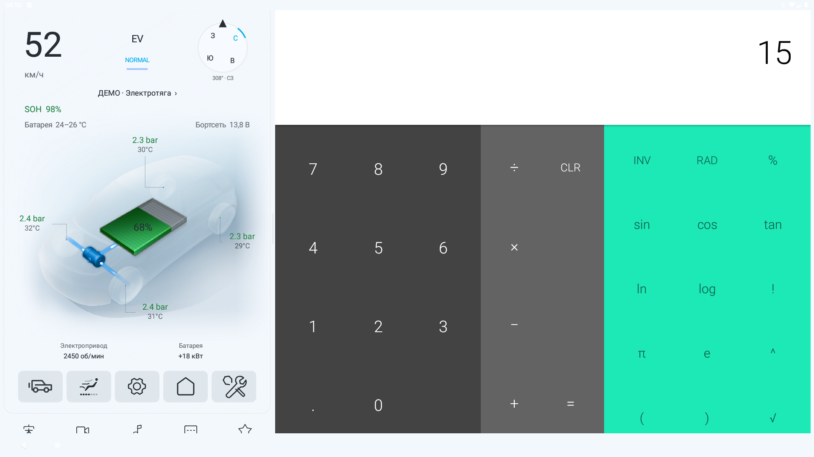
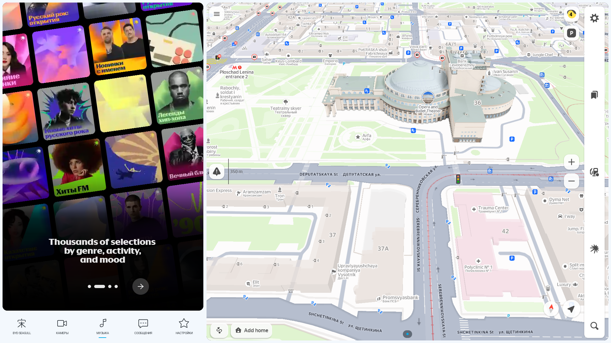
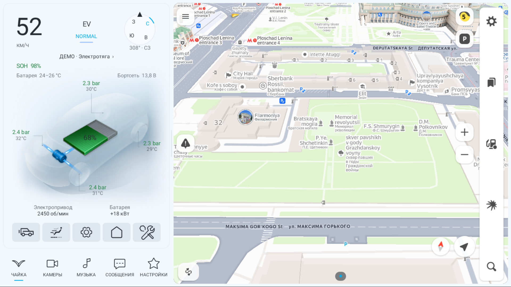
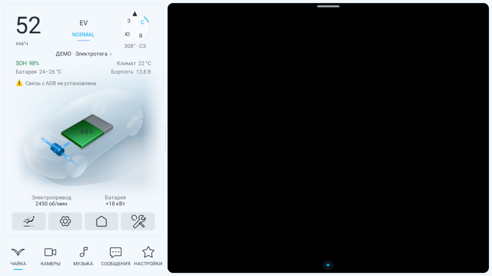
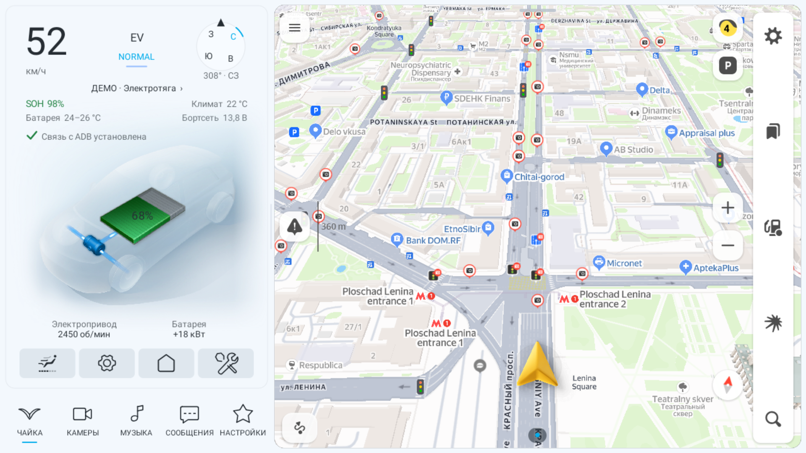

# Эмулятор BYD Seagull / Android 9

## Что удалось установить

Штатный поворотный экран Seagull — **10,1 дюйма**, а не 10,8.
Это подтверждено владельцем и [спецификацией BYD](https://www.byd.com/content/dam/byd-site/co/product/seagull/flyer/BYD-SEAGULL-flyer-ES-20231229.pdf).

В найденной официальной спецификации нет точного разрешения и логической
плотности Android. В [документации другого проекта владельца для DiLink 2](https://github.com/hix83/BYDMate-DiLink2-Seagull/blob/dilink2-seagull/docs/DILINK2_HANDOFF.md)
описана проверка эмулятора Android 9 при **1920×1080**. Это полезная исходная
конфигурация для разработки, но не измерение штатного дисплея.

## Созданная конфигурация

| Параметр | Значение |
| --- | --- |
| AVD | `BYD_Seagull_DiLink2_API28` |
| Система | AOSP Android 9, API 28, без Google Play Services |
| Образ | `system-images;android-28;default;x86_64` |
| Экран | 1920×1080, landscape — предварительный профиль |
| Логическая плотность | 160 dpi — рабочая; system/build.prop содержит 160, vendor/build.prop — 480, runtime требует проверки |
| Оперативная память / CPU | 2048 МБ / 4 ядра — ресурсы эмулятора |
| Данные | 4 ГБ |
| ADB | `emulator-5560` |

Диагональ 10,1″ описывает физический экран автомобиля. Физический PPI
нельзя подставлять вместо `wm density`: Android использует логическую
плотность для размеров интерфейса. Размер окна на мониторе компьютера
также не воспроизводит физическую диагональ автомобильного дисплея.

Это обычный AOSP, без прошивки DiLink, автомобильных сервисов, CAN,
штатного климата и приборки. Подходит для проверки интерфейса и API 28;
совместимость автомобильных функций подтверждается на машине.

## Запуск в PowerShell

```powershell
.\tools\seagull-emulator.ps1
# Установить уже собранный debug APK и открыть демонстрационный режим:
.\tools\seagull-emulator.ps1 -InstallApp
```

SDK определяется из `ANDROID_HOME`, `ANDROID_SDK_ROOT` или `local.properties`.
При первом создании нужен действующий `JAVA_HOME` (JDK 17), либо параметр
`-JavaHome 'C:/path/to/jdk-17'`. Можно передать `-SdkRoot 'D:/Android/Sdk'`.
Режим `-SetupOnly` только создаёт AVD. Существующий профиль не перезаписывается.
Логи запуска сохраняются в игнорируемом каталоге `tmp/seagull-emulator`.

Скрипт также настраивает `adb reverse tcp:5555 tcp:PORT_PLUS_ONE` для
встроенного ADB-клиента лаунчера. Например, при `-Port 5560` используется
хостовый порт ADB `5561`. Без этого AOSP adbd принимает команды компьютера,
но лаунчер внутри эмулятора не может подключиться к `127.0.0.1:5555`.
После перезапуска AVD/adbd повторно выполнить скрипт. Это настройка только
эмулятора; на машине нужен её локальный ADB, а не reverse к компьютеру.

На API 28 виртуальными дисплеями теперь владеет `ShellDisplayDaemon`.
Он получает поверхность панели через Binder и сам создаёт InputForwarder:
Android 9 одновременно требует владение дисплеем и `INJECT_EVENTS`.
Публичный дисплей позволяет размещённым приложениям получать его DisplayInfo;
прежний private-дисплей приводил к падению стороннего приложения с
`ViewRootImpl.onMovedToDisplay: Display.getState() on null`.
Протокол принимается только от UID лаунчера; регистрация помощника разрешена
только shell/root. При завершении процесса лаунчера помощник освобождает
дисплеи и завершается. Для процесса выделено отдельное постоянное ADB-соединение
без тайм-аута разовой команды; транспорт запуска приложений остаётся отдельным.
Это устраняет исчезновение дисплея через 15 секунд и возврат приложения на
основной экран. Изменения не требуют root и не выдают приложению
системное разрешение `INJECT_EVENTS`.

Запуск проверяется по видимой задаче на точном displayId после переноса,
с повторным чтением списка задач. displayId=3 больше не совпадает с 30.
Поддерживаются форматы Android 9 `Stack id=` и новых версий `RootTask id=`.

## Проверка ввода на Android 9

После запуска AVD и настройки reverse:

```powershell
.\gradlew.bat assembleDebug assembleDebugAndroidTest
adb -s emulator-5560 install -r app/build/outputs/apk/debug/app-debug.apk
adb -s emulator-5560 install -r app/build/outputs/apk/androidTest/debug/app-debug-androidTest.apk
adb -s emulator-5560 shell am force-stop ru.logunov.bydsplit.test
adb -s emulator-5560 shell am instrument -w -e pane far ru.logunov.bydsplit.test/ru.logunov.bydsplit.EmbeddedInputInstrumentation
# Для левой панели сначала выбрать Музыку в нижней панели лаунчера:
adb -s emulator-5560 shell am force-stop ru.logunov.bydsplit.test
adb -s emulator-5560 shell am instrument -w -e pane driver ru.logunov.bydsplit.test/ru.logunov.bydsplit.EmbeddedInputInstrumentation
```

Тестовый APK содержит отдельное приложение-приёмник. Проверяется реальный
диспетчер окон Android 9, а не подставной ответ помощника: запуск на
виртуальном дисплее, tap, отложенный tap, swipe, multi-touch с ID 3/7,
ACTION_CANCEL, Back, координаты и единый downTime. Дополнительно выполняется
нажатие через UiAutomation на основной экран в координатах выбранной панели:
приёмник должен получить локальные координаты, а не абсолютные. Проверка
повторяется после ожидания 17 секунд — дольше прежнего тайм-аута ADB. Успешный результат
начинается с `PASS: far:` или `PASS: driver:`. Тест переводит лаунчер в демо-режим,
запускает приёмник в выбранной панели и возвращает установленную Яндекс Музыку
слева или Навигатор справа. Перед повторным запуском нужно остановить тестовый
пакет: его старое окно может ссылаться на уже удалённый дисплей. Тестовые Activity
и Provider не входят в обычный APK. Удаление тестового пакета:
`adb -s emulator-5560 uninstall ru.logunov.bydsplit.test`.

Ручная проверка: после обычного запуска вычислено `7 + 8 = 15` касаниями
по правой панели; проведён свайп, проверен повторный запуск.
Реальное устройство DiLink 2 остаётся отдельной аппаратной проверкой.

## Уточнение по машине

На реальном автомобиле выполнить с явно указанным ADB serial:

```text
adb -s SERIAL shell wm size
adb -s SERIAL shell wm density
adb -s SERIAL shell getprop ro.build.version.release
adb -s SERIAL shell getprop ro.build.version.sdk
adb -s SERIAL shell dumpsys display
```

После получения значений скорректировать `hw.lcd.width`, `hw.lcd.height`
и `hw.lcd.density` в config.ini выключенного AVD и шаблон скрипта.
Системные панели AOSP отличаются от DiLink; доступную область окна
также нужно проверить на автомобиле.




## Яндекс-приложения: проверка 15 октября 2026

Установлены оригинальные универсальные APK из официального RuStore:

| Приложение | Пакет | Версия | minSdk |
| --- | --- | --- | --- |
| [Яндекс Музыка](https://www.rustore.ru/catalog/app/ru.yandex.music) | ru.yandex.music | 2026.09.5 #167.1rur (24026502) | 24 |
| [Яндекс Навигатор](https://www.rustore.ru/catalog/app/ru.yandex.yandexnavi) | ru.yandex.yandexnavi | 31.1.3 (739706920) | 26 |

Оба APK содержат x86_64/x86 и ARM. Подписи проверены `apksigner verify`;
SHA256 сертификата обоих пакетов:
`aca405ded8b25cb2e8c6da69425d2b4307d087c1276fc06ad5942731ccc51dba`.
SHA256 APK Музыки: `a65972608b532fa578c66649dfe50d37d1b2d1a31c491dd9cc3473629200a71a`;
Навигатора: `072acc2a347c07cfcf313e7e2107d335c5a8796f7ec644582ae65ab41edda83b`.
Локальные APK и метаданные загрузки находятся в игнорируемом `tmp/yandex-apps`.

В режиме GPU auto эмулятор объявлял OpenGL ES 2 (131072), Навигатор падал
с `eglChooseConfig() failed`. Проверенный запуск: `-gpu swiftshader_indirect
-feature GLESDynamicVersion`; теперь `ro.opengles.version=196608` (ES 3).
Скрипт использует этот режим по умолчанию; `-GpuMode host` / `auto` доступны
для сравнения. Это настройка эмулятора, не изменение APK или режима автомобиля.

Ручные касания отправлялись на основной экран: слева кнопка и горизонтальный
свайп меняют страницы знакомства Музыки; справа свайп перемещает карту,
кнопка масштаба изменяет детализацию. Использована тестовая GPS-точка в центре
Новосибирска. Аккаунт не подключён, воспроизведение музыки не проверялось.
Экран согласия/знакомства Музыки создаёт отложенную Activity в новом стеке
основного дисплея. В `launchOnDisplay` добавлено ограниченное наблюдение
старта на API 28: ещё 8 чтений через 300 мс с переносом видимого стека
только запускаемого пакета. Повторный запуск обеих программ проверен:
EntryScreenActivity Музыки остаётся слева, NavigatorActivity справа.

Отдельные запуски instrumentation с `pane=driver` и `pane=far` завершились PASS:
чужой UID, передача касания с основного экрана в панель, локальные координаты,
отложенное нажатие, свайп, два указателя ID 3/7, cancel, Back, времена событий
и сохранение соединения более 17 секунд. Мультитач подтверждён тестовым
приёмником; жест двумя пальцами в самой карте отдельно не проверялся.




## Читаемость при 1366×768

По запросу владельца проверена компоновка с `adb shell wm size 1366x768`
при плотности 160. Это тестовое разрешение, подтверждение штатного экрана
на автомобиле всё ещё требуется. Физический framebuffer AVD остаётся
1920×1080, поэтому screencap сохраняет масштабированную картинку этого размера.
Значок Song в нижней панели заменён векторной чайкой с подписью «ЧАЙКА».
Подписи кнопок увеличены с 9,5 до 12 sp; текст приборной панели — на 12%,
минимальный размер вне масштабируемой сцены — 14 sp. Подписи списка
приложений увеличены с 12 до 14 sp. Компоновка 1:2 и схема автомобиля сохранены.

Владелец сообщил о необновлении левой панели при переключении на Музыку.
По его просьбе в этой итерации механизм поверхностей, запуска и передачи
касаний не менялся; расследование отложено до проверки на настоящем DiLink 2.




## Отложенное появление ADB (19 октября 2026)

Лаунчер теперь проверяет доступность локального ADB и помощников до
завершения MainActivity, включая время, когда встроенное приложение имеет
фокус. После неудачи новая проверка планируется через 5 секунд после
завершения предыдущей; после успеха — через 15 секунд. Общего лимита
попыток нет. Проверка работает вне UI-потока и очереди касаний; одновременно
выполняется одна попытка. Завершение Activity останавливает мониторинг.

Проверяется реальная команда `echo BYD_ADB_READY`, а не только состояние
TCP-сокета. Для API28 проверяется Binder помощника дисплеев, для остальных
API — ping ввода; дополнительно проверяется помощник руля вне демо-режима.
Работающие помощники не перезапускаются при каждом успешном опросе.
После появления связи повторно запускаются ожидающие или неудачно
запущенные панели. Если дисплей старого помощника удалён Android, создаётся
новый. Рабочие панели и их Surface не пересоздаются. Известный артефакт
обновления Музыки этой правкой отдельно не исправляется.

ADB включает внешнее устройство, как и раньше. Мониторинг не включает
adbd и не обходит его авторизацию: существующий ключ лаунчера должен быть
разрешён. Пять секунд — пауза между попытками, а не гарантированное время
восстановления: подключение, авторизация и запуск команд могут занять дольше.
Это не механизм запуска force-stopped приложения.

Проверка на AOSP API28: остановлен только лаунчер эмулятора, удалён reverse
`tcp:5555`, запущен лаунчер. Через 13 секунд (дольше прежнего ожидания панели)
подтверждено отсутствие виртуального дисплея, затем восстановлен reverse
`tcp:5555 tcp:5561`. Помощник зарегистрировался, Навигатор оказался в виртуальной
панели, PID лаунчера сохранился. Через следующие 17 секунд PID помощника
не изменился: здоровый процесс не был перезапущен очередной проверкой.
Этот сценарий пока не повторён на настоящем автомобиле.

Тест `AdbHelperRecoveryTest` дополнительно проверяет несколько минут отсутствия
ADB, повторную потерю связи, исключение при опросе, отсутствие параллельных
цепочек и остановку при завершении владельца. Входит в tools/test_logic.sh.


### Индикатор подключения ADB

Под температурой батареи отображается строка состояния: жёлтый треугольник
с «!» и «Связь с ADB не установлена» до успешной проверки; зелёная галочка
и «Связь с ADB установлена» после ответа ADB и готовности помощника экрана.
Демо-показатели автомобиля не подменяют это состояние: ADB проверяется реально.
Результат каждой фоновой проверки передаётся в UI, включая потерю связи.
При возвращении к панели автомобиля восстанавливается последнее проверенное
состояние; при новом запуске до проверки показывается предупреждение.
Разрыв отражается после очередного опроса/тайм-аута, не мгновенно.

Проверено в API28 с override 1280×720 / 160 dpi: отсутствие ADB при старте,
затем подключение reverse без перезапуска приложения. Обе строки помещаются
в левой трети экрана. Снимки framebuffer эмулятора имеют физический размер
1920×1080. Контроллер также проверен тестом потери связи после успешного
подключения и отсутствия UI-уведомлений после закрытия.






Уточнение индикации: после подключения текст виден 3 секунды, затем
плавно исчезает за 600 мс. Зелёная галочка остаётся. Повторный успешный
опрос не запускает надпись заново; потеря связи немедленно при получении
результата проверки возвращает полное предупреждение. Проверено визуально
в эмуляторе; снимок docs/screenshots/seagull/adb-status-check-only.png.
