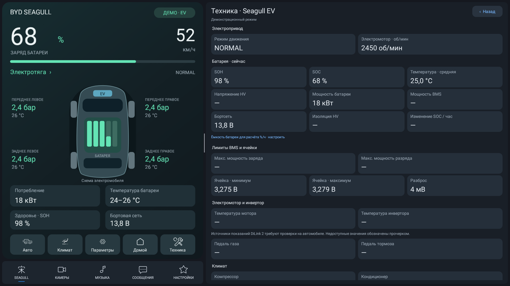

# BYD Seagull: начало разработки

Ветка `seagull` создана от `main` / `147a17c`, версия исходника 0.9.1.
Исходный проект: https://github.com/hix83/BYD-Split.

## Целевая конфигурация

- BYD Seagull, Android 9 / API 28, DiLink 2.
- Штатный экран 10,1 дюйма (уточнено владельцем); разрешение и плотность
  требуют проверки на устройстве. [Эмулятор Android 9](SEAGULL-EMULATOR.md).
- Приоритет: дизайн под экран автомобиля и адаптация ADB-помощников.
- Возможности Song L DM-i переносить выборочно после проверки применимости.

## Исходное состояние

Исходные параметры сборки:
`minSdk 27`, `compileSdk 35`, `targetSdk 35`, Java 17.
Минимальный SDK допускает Android 9, но это не подтверждает совместимость
виртуальных дисплеев, скрытых API, ввода, климата и автомобильных сервисов.
Существующие `tools/*.sh` ориентированы на исходный автомобиль;
адрес ADB по умолчанию нельзя считать адресом Seagull.

## Интерфейс Seagull

Добавлены дневная/ночная палитры из OTA Di5 и выбор «Как в автомобиле»
в настройках. [Исследование прошивок, каталог SDK и ресурсы](firmware/README.md).

Сохранены исходный стиль UI7, изометрическая схема автомобиля,
размещение батареи и электропривода, подписи шин, компас, кнопки и
пропорции областей 1:2. Владелец предпочитает эту исходную компоновку:
не заменять её новой схемой и не перестраивать без отдельного запроса.

Из панели и экрана техники убраны ДВС, бак, топливо, генератор,
гибридные режимы и задний электромотор. Демо включает электротягу,
рекуперацию, зарядку и стоянку; переключение — нажатием на название
сцены. Нажатие на SOH открывает батарею, кнопка «Техника» —
расширенные показатели электромобиля. Старые классы чтения данных пока
сохранены для последующей адаптации DiLink 2.

Проверено на Android 9: запуск, батарея и техника, перестановка панелей,
отсутствующая телеметрия (прочерки). Gradle assembleDebug/lintDebug и
отдельные тесты логики проходят. Связь с автомобилем не проверялась.



## Следующие этапы

1. Снять характеристики устройства через ADB: `getprop ro.build.version.sdk`,
   `getprop ro.build.version.release`, `wm size`, `wm density`.
   Уточнить ориентацию, системные панели и доступность разрешений.
2. Проверить создание виртуальных дисплеев и запуск приложений на API 28.
3. Проверить и адаптировать ShellInputDaemon, помощники рулевых кнопок
   и способы их запуска для DiLink 2.
4. Переработать размеры, сетку, типографику и зоны касания под реальный экран.
5. Проверить доступную телеметрию электромобиля и убрать из интерфейса
   неприменимые гибридные элементы.
6. До установки определить applicationId, подпись и отдельный канал
   обновлений Seagull. Сейчас сохранён канал исходного проекта.

## Работа с исходным проектом

`origin/main` остаётся источником будущих переносов.
Обновить ссылки: `git fetch origin`.
Перенести выбранное изменение: `git cherry-pick -x <commit>`.
После каждого переноса проверить сборку и поведение на Android 9.

## Локальная сборка

Нужны JDK 17, Android SDK Platform 35 и Build Tools 35.0.0.
Путь SDK задаётся в `local.properties` (`sdk.dir=...`), файл игнорируется Git.
В PowerShell:

```powershell
.\gradlew.bat assembleDebug lintDebug testDebugUnitTest
```

Дополнительные тесты логики: `./tools/test_logic.sh` в POSIX-окружении
либо компиляция перечисленных в нём классов через JDK 17.
Debug APK: `app/build/outputs/apk/debug/app-debug.apk`.
