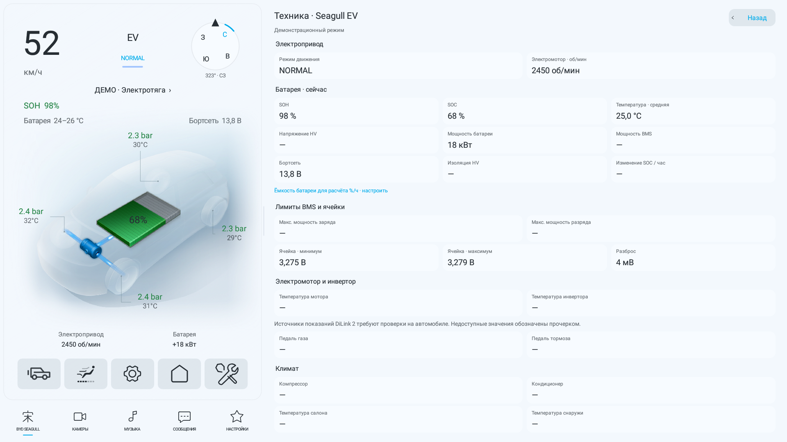
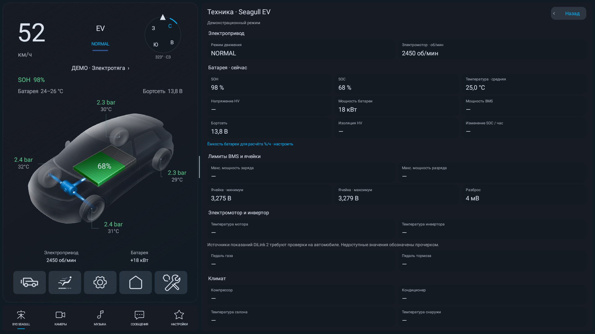

# Исследование OTA Seagull

Исходные архивы владельца остаются локально в корне проекта и исключены
из Git. Распаковка и декомпиляция — в игнорируемом `tmp/`.

## Di2: Android 9 и каталог SDK

Архив: `Di2.2H_ota_26.1.1.2511070.1.zip`, внутри `update.zip`.
`system.new.dat.br` распакован Brotli и восстановлен по `system.transfer.list`
в `tmp/ota-di2/system.img`. Извлечены framework, SystemUI, CarSetting,
CarSettingsProvider и SystemSettings. Декомпиляция JADX 1.5.6 находится в
`tmp/ota-di2/carsetting`, `settings`, `systemui`. JADX сообщил ошибки в
отдельных методах; приведённые ниже места прочитаны отдельно, это не
заявление о полной точности декомпиляции всего APK.

`system/build.prop`: `ro.build.version.sdk=28`, `ro.sf.lcd_density=160`.
Дополнительная проверка `vendor/build.prop` обнаружила другое значение
`ro.sf.lcd_density=480`. Поэтому по отдельному build.prop нельзя утверждать
эффективную плотность автомобиля: нужны `getprop ro.sf.lcd_density` и
`wm density` на самом устройстве. Плотность эмулятора 160 пока рабочая.

### Проверка предположения 1366×768

Подтверждения 1366×768 для Seagull 10,1″ в открытых источниках не найдено.
На BYD TIS это число относится к рекомендованному разрешению монитора
компьютера для сервисного сайта, а не к дисплею автомобиля.
Региональный сайт [BYD Ecuador](https://bydauto.ec/project/seagull/) описывает
экран 10,1″ как FHD, но это не подтверждает комплектацию Di2 владельца.

В `dtbo.img` из предоставленной Di2 OTA, FDT по смещению `0x40`, найдены:

```text
fragment@6/__overlay__/focaltech@38: focaltech,display-coords = <0 0 1280 720>
fragment@6/__overlay__/hxchipset_ts@49: himax,panel-coords = <0 1280 0 720>
fragment@6/__overlay__/hxchipset_ts@49: himax,display-coords = <0 1280 0 720>
fragment@6/__overlay__/nvt519xx@14: novatek,display-coords = <0 0 1280 720>
fragment@6/__overlay__/nvt51917@01: novatek,display-coords = <0 0 1280 720>
fragment@9/__overlay__: tpd-resolution = <720 1280>
```

Это прямое свидетельство конфигурации координат тачскрина 1280×720 в OTA,
но не окончательное доказательство разрешения активной матрицы конкретного
автомобиля: нужны выбранный драйвер и runtime-конфигурация дисплея.
Разрешение эмулятора 1920×1080 остаётся предварительным и в рамках этой
проверки не менялось. Для подтверждения: `adb -s SERIAL shell wm size`,
`adb -s SERIAL shell dumpsys display` (проверить основной дисплей,
физический режим и возможный override).

В [di2-sdk-usage.json](di2-sdk-usage.json) перечислены 20 SDK-классов
`android.hardware.bydauto.*` и файлы штатного CarSetting, которые их
используют. Это каталог мест использования, не таблица Binder-транзакций.

Подтверждённые примеры из **Di2**, пути относительно декомпилированного
`CarSetting/sources/com/byd`:

| Назначение | Штатный API | Источник |
| --- | --- | --- |
| SOC | `statistic.BYDAutoStatisticDevice.getElecPercentageValue()` | `newenergy/model/EnergyFlowModel.java` |
| SOC, целое | `statistic.BYDAutoStatisticDevice.getSOCBatteryPercentage()` | `newenergy/model/DischargeLimitModel.java` |
| Состояние потоков энергии | `energy.BYDAutoEnergyDevice.getEnergyState()` | `newenergy/model/EnergyFlowModel.java` |
| Конфигурация привода | `setting.BYDAutoSettingDevice.getDriveConfig()` | `newenergy/model/EnergyFlowModel.java` |
| Состояние света | `light.BYDAutoLightDevice.getLightStatus(1)` | `dilink/model/DisplayModel.java` |
| Данные шин | `tyre.BYDAutoTyreDevice` | `common/utils/bydautoapi/CommonBYDAutoFeatureIds.java` |
| Климат | `ac.BYDAutoAcDevice` | каталог использующих его классов в JSON |

Существующий `LocalAdbManager` пока содержит команды от исходного Di5.
Не считать их проверенными адресами Seagull/Di2. В этой работе они не
заменены номерами из Di5. Для следующего этапа добавлен `Di2SdkProbe`:
он через reflection выводит сигнатуры SDK и константы BYDAutoFeatureIds
из framework **самого подключённого устройства**, не вызывая методов
управления машиной. На AOSP ожидается `ClassNotFoundException`.

После установки текущего APK собрать метаданные на автомобиле:

```powershell
.\tools\collect-di2-sdk.ps1 -Serial 'АДРЕС_ИЛИ_SERIAL_МАШИНЫ'
```

Результат — `tmp/di2-sdk-runtime/`: SDK, список сервисов и состояние
день/ночь. Точные вызовы и масштабы значений нужно сверить с Di2 framework
и затем проверить чтением на машине; управляющие команды — отдельно.

## День/ночь автомобиля

Di2 `SystemUI`, `ConBaseItem.java`, методы `onConfigChangeListener` и
`updateIcon` используют `Configuration.uiMode & 48`, ночь — `32`.
Лаунчер следует этому же сигналу в автоматическом режиме. Android
пересоздаёт Activity при смене `uiMode` и загружает ресурсы `values-night`.

Дополнительный сигнал: provider `content://carsettings/global`,
колонка `name=sys_day_or_night`, значение в `value`.
В `UserBrightness.updateMultiMediaBrightness` ночь записывается как
`false`, день — `true`; `DisplayModel.getBrightnessOfLittleLantern`
читает его как `isDaytimeMode`. Это состояние яркости, поэтому оно
используется только когда Android не публикует тему (`UI_MODE_NIGHT_UNDEFINED`).
Provider экспортирован в манифесте CarSettingsProvider; отсутствие
provider/доступа корректно обрабатывается. Приложение не меняет настройки
темы или яркости автомобиля.

## Di5: ресурсы и палитра

Архив: `Di5.0_23.1.22.2510203.1_0.zip` → `update.zip` → `payload.bin`.
Извлечены и проверены payload-dumper-go 2.1.0 разделы `system`,
`system_ext`, `product`. APK находятся в `tmp/ota-di5/extracted`;
декомпиляция CarSetting и CarSettingsPlugins — в одноимённых каталогах.

Это общий пакет с ресурсами многих моделей. Штатный код
`AbsEnergyConfigCommon.initCarImage()` выбирает общие кузова по типу
SUV / ATV / MPV / CROSS, а некоторые другие экраны выбирают ресурсы по
vehicleId и данным `/storage/emulated/0/carbody/carInfo.json`.
По одному имени OTA точный кузов Seagull не установлен.

Сохранена прежняя изометрическая схема. По выбору владельца SUV-шаблон
заменён похожим на Seagull заводским CROSS-силуэтом. Для него
импортированы **без изменения пикселей** заводские дневной/ночной кузов
и тень (`newenergy_flow_car_img_cross*`), а также иконка `common_back`.
Это общий заводской шаблон, не подтверждённый точный силуэт Seagull.
После получения vehicleId/carInfo можно выбрать соответствующий ресурс,
сохраняя компоновку и проверяя координаты компонентов.

[di5-resource-map.json](di5-resource-map.json) хранит исходные имена цветов,
значения, пути и SHA-256 импортированных картинок.

| Роль | День | Ночь |
| --- | --- | --- |
| Общий фон | `#F3F8FD` | `#111B23` |
| Фон энергии | `#F3F8FD` | `#171B23` |
| Основной текст | `#262D33` | `#DAE1EB` |
| Вторичный текст | `#B3262D33` | `#B3DAE1EB` |
| Кнопка | `#266A8497` | `#406A8497` |
| Акцент | `#00ACEB` | `#00ACEB` |

Цвета успеха/предупреждения адаптированы для читаемости, они не выданы за
извлечённые заводские токены. Основные цвета взяты из CarSetting
`res/values/colors.xml` и `res/values-night/colors.xml`.

Настройки → Основные → Оформление: «Как в автомобиле», «Дневная»,
«Ночная». Ручной выбор хранится в `theme_mode` и влияет только на
лаунчер. Внешние приложения внутри окон используют собственное оформление.

Проверки: переключение системного `cmd uimode night no/yes` на API 28,
ручная дневная тема при ночной системной теме, возврат в авто, главный
экран, батарея, техника и настройки. В `ThemePolicyTest` проверяется
приоритет ручного выбора, Android-темы и резервного сигнала Di2.
На реальном автомобиле синхронизация и доступ к SDK ещё не проверены.



