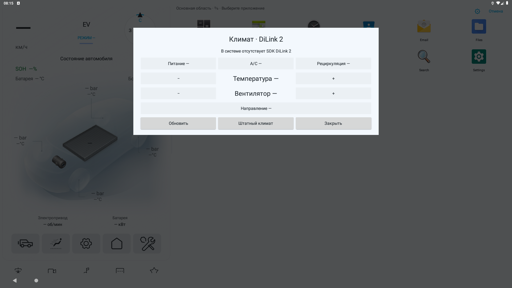

# Помощник DiLink 2

Реализован для Seagull / Android 9 (API 28). Основание — **предоставленная
Di2.2H_ota_26.1.1.2511070.1.zip**, а не SDK или Binder-адреса Di5.
На автомобиле пока не проверен. Наличие метода в многомодельной прошивке
не означает наличие соответствующего датчика в комплектации.

## Источник контракта

`system/framework/boot-framework.vdex` извлечён из восстановленного system.img.
SHA-256 VDEX: `7f279f6a1197b21aa09b852f6940dc877a28ea3818e6ceb5476c9d07cce84418`.
vdexExtractor восстановил quickened-инструкции и выгрузил три Compact DEX.
Локальные результаты: `tmp/ota-di2/framework-dex/`, `framework-dis.txt`,
`BYDAuto*Device.dis`. В репозиторий проприетарные классы не включаются.
CarSetting подтверждает штатное применение `getElecPercentageValue()`;
AirConditioning APK подтверждает компонент и контракт запуска штатного климата.

Мост запускается из установленного APK через `app_process` под авторизованным
ADB shell и получает `ActivityThread.systemMain().getSystemContext()`.
SDK-классы загружаются reflection из framework **самой машины** и создаются
через `getInstance(Context)`. Разрешения OEM сохраняются: мост не подменяет
проверки permission и не меняет права приложений.

| Показание | Метод в `android.hardware.bydauto` | Обработка |
| --- | --- | --- |
| Скорость | `speed.BYDAutoSpeedDevice.getCurrentSpeed(): double` | 0–300, округление до км/ч |
| Заряд | `statistic.BYDAutoStatisticDevice.getElecPercentageValue(): double` | 0–100 % |
| Пробег | `statistic.BYDAutoStatisticDevice.getTotalMileageValue(): int` | SDK уже умножил raw на 0,1; повторного масштаба нет |
| Давление | `tyre.BYDAutoTyreDevice.getTyrePressureValue(int): int` | области 1=ПЛ, 2=ПП, 3=ЗЛ, 4=ЗП; 100–500 кПа |
| Питание | `ac.BYDAutoAcDevice.getAcStartState()` | 0/1 |
| Вентилятор | `getAcWindLevel()` | 0–7 |
| Направление | `getAcWindMode()` | 1–7, перечисление, не битовая маска |
| Рециркуляция | `getAcCycleMode()` | 0/1 |
| A/C | `getAcCompressorMode()` | 0/1 |
| Единицы температуры | `getTemperatureUnit()` | 0=°F, 1=°C |
| Уставка | `getTemprature(1)` | опечатка `Temprature` находится в оригинале SDK |

Масштаб скорости и давления нужно подтвердить сопоставлением с приборной
панелью машины; до этого аппаратная совместимость не объявляется.
`getTemprature(3)` и `(4)` возвращаются только как `insideRaw` / `outsideRaw`
в диагностическом JSON. Перевод датчиков в °C пока не установлен, поэтому
они не используются температурными автоматизациями.

В `instrument.BYDAutoInstrumentDevice.getWheelPressure/getWheelTemperature`
другой порядок областей: 1=ПП, 2=ЗП, 3=ПЛ, 4=ЗЛ. Он не переносится в tyre SDK.
Проверены switch-таблицы Compact DEX: tyre pressure по адресу shared data
`0x266448` — ключи 1..4, смещения `0x25,0x1b,0x11,0x07`;
AC temperature `0x23aea0` — ключи 0..3, смещения `0x4f,0x36,0x1d,0x04`.

## Управление климатом

Кнопка климата на прежней панели открывает отдельное окно, схема автомобиля
сохраняется. Доступны только функции с прочитанным допустимым состоянием.
Есть кнопка запуска штатного климата. В демо-режиме команды отключены.
Кнопки показывают состояние при открытии, после команды и по «Обновить».

| Команда | Вызов SDK | Допустимое значение |
| --- | --- | --- |
| `power` | `start(0)` / `stop(0)` | 1 / 0 |
| `temperature` | `setAcTemperature(1, value, 0, 1)` | 18–32 °C |
| `fan` | `setAcWindLevel(0, value)` | 0–7 |
| `wind` | `setAcWindMode(0, value)` | 1–7 |
| `recirculation` | `setAcCycleMode(0, value)` | 0/1 |
| `compressor` | `setAcCompressorMode(0, value)` | 0/1 |

`setAcTemperature`: первый аргумент — зона (1=основная; 0=обе передние,
2=пассажирская, 3=задняя), третий — source=0, четвёртый — unit=1 (°C).
Внутренние LO/HI границы SDK 17/33 не предлагаются как обычные температуры.
Помощник не переключает °F/°C: при °F команда температуры блокируется.

До записи читается исходное состояние; при недоступном показании запись
не отправляется. Неотрицательный результат setter сам по себе не означает
успех: четыре чтения с паузами 250 мс должны подтвердить нужное значение.
Статусы: `confirmed`, `rejected`, `unconfirmed`, `read_unavailable`,
`celsius_required`, либо ошибка доступа/SDK. Тайм-аут процесса — 8 секунд.
Неудачная команда не повторяется автоматически.

## Запуск с компьютера

Установить текущий APK и указать serial авторизованного ADB-подключения.
`read` / `climate` выполняют только чтение. Команды ниже с `-Value`
**управляют реальным климатом**, если автомобиль и разрешения доступны.

```powershell
.\tools\di2-vehicle.ps1 -Serial SERIAL -Command read
.\tools\di2-vehicle.ps1 -Serial SERIAL -Command climate
.\tools\di2-vehicle.ps1 -Serial SERIAL -Command temperature -Value 24
.\tools\di2-vehicle.ps1 -Serial SERIAL -Command fan -Value 3
```

При необходимости передать `-Adb 'путь/adb.exe'`. JSON начинается маркером
`BYD_DI2_V1 `: системные сообщения app_process не разбираются как показания.
В JSON `values` содержит только допустимые числа, `errors` — причины
отсутствия остальных. Пустой ответ/ошибка/неподтверждённая запись дают код 2.
Неверные аргументы отбрасываются до обращения к SDK. Произвольный метод,
Binder-номер или shell-команду через этот интерфейс передать нельзя.

Для инвентаризации без обращения к датчикам остаётся
`tools/collect-di2-sdk.ps1`. На автомобиле также нужны `adb shell id` и
вывод `read`: SDK проверяет `BYDAUTO_*_COMMON/GET/SET`, и обычный shell UID
может не иметь OEM-разрешений. При отказе показывается `SecurityException`;
помощник не пытается получить root или обойти ограничения. Работоспособность
под конкретным UID необходимо проверить на машине.

## Остальные помощники Android 9

`InputEvent.setDisplayId` и `input -d` отсутствуют в AOSP API 28.
После проверки реальной пересылки выяснилось, что shell не может создать
InputForwarder для дисплея, принадлежащего UID лаунчера. Сам лаунчер не имеет
INJECT_EVENTS. Поэтому на API 28 `ShellDisplayDaemon` создаёт и дисплей,
и InputForwarder под авторизованным shell. Поверхность, касания и команды
жизненного цикла передаются через Binder, доступный только UID лаунчера.
Bootstrap provider разрешает регистрацию только shell/root. Помощник работает
через отдельное постоянное ADB-соединение; разовые команды не обрывают его
по 15-секундному тайм-ауту. При смерти
лаунчера помощник освобождает свои дисплеи и завершается.
На новых версиях сохраняется прежний shell-механизм setDisplayId.

Дисплей PUBLIC + OWN_CONTENT_ONLY позволяет сторонним приложениям получать
его параметры. Проверка запуска использует точный displayId и видимую задачу
после переноса; `Stack id=` Android 9 поддерживается вместе с `RootTask id=`.
Неподдерживаемая команда wm запускается только начиная с API 31.
Подробности и инструментальный тест: [SEAGULL-EMULATOR.md](../SEAGULL-EMULATOR.md).

Старые вызовы `service call autoservice` Di5 убраны из LocalAdbManager:
телеметрия, батарея, техническая панель, температурные правила и команды
комфорта больше не обращаются по ним. SOH, напряжения ячеек, мощность,
обороты привода и температуры шин/батареи пока остаются недоступными;
нулевые значения вместо отсутствующих не подставляются. Обогревы руля,
сидений и вентиляция из правил Song L отключены до подтверждения Di2 API
и наличия функций на Seagull. Прочие функции исходного проекта (например,
отправка музыки на приборную панель) этим изменением не сертифицированы.

## Проверки

- `assembleDebug`, `lintDebug`; Gradle unit tests: `NO-SOURCE`.
- `tools/test_logic.sh`: все проверки, включая fake SDK, параметры setter,
  readback, отказ permission, неверные единицы/значения, отсутствующие данные,
  отсутствие повторных/неподтверждённых записей и форматы задач Android 9.
- AOSP API 28: shell-мост чтения и записи возвращает ClassNotFoundException
  без вымышленных показаний; экран климата блокирует органы управления.
- Встроенный ADB-клиент и разбор ответа проверены на эмуляторе через временный
  reverse `tcp:5555 → tcp:5561` (хостовый порт ADB этого AVD).
- API 28 инструментальный тест отдельным APK: запуск стороннего приложения
  на shell-дисплее, tap, отложенный tap, swipe, multi-touch, cancel, Back,
  локальные координаты, временные метки и касание основной панели через
  UiAutomation после прежнего тайм-аута ADB — PASS. Ручные касания калькулятора
  в правой панели и перезапуск лаунчера также проверены.
- Реальные датчики, климат и OEM-разрешения требуют проверки на машине.


