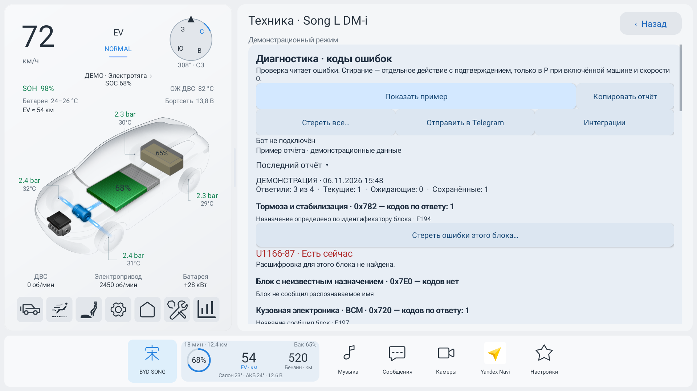
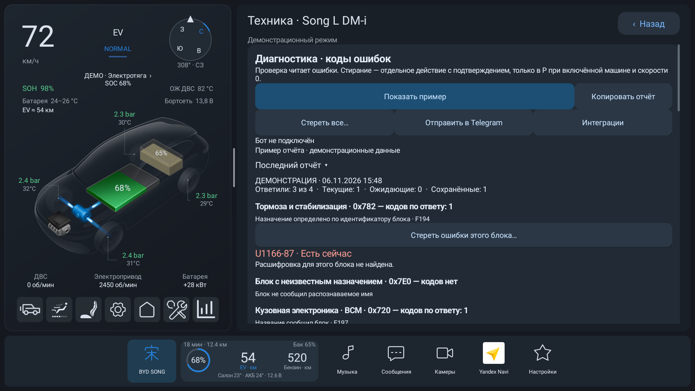
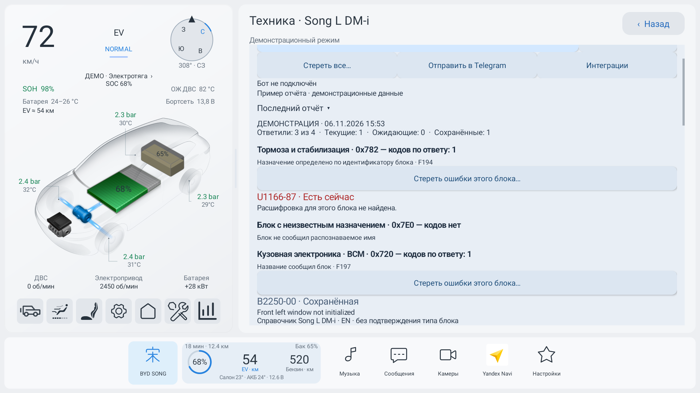
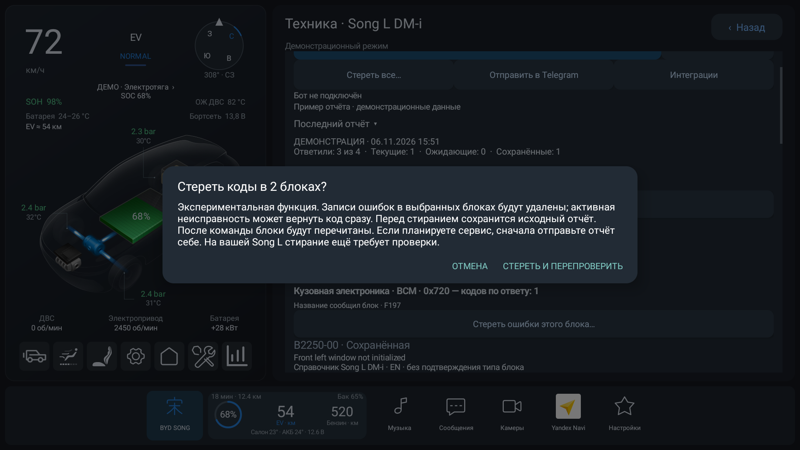
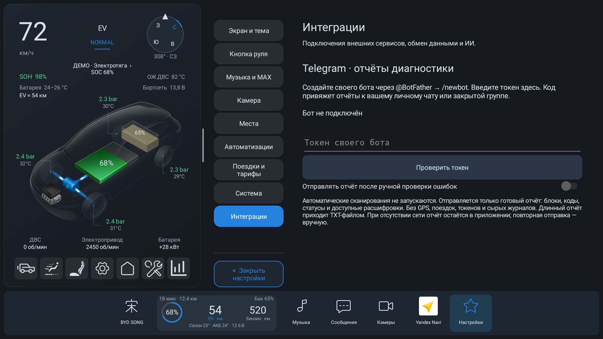

# BYD Split 0.9.8 · Song

**Больше смысла в диагностике и новый дом для подключённых сервисов.** Ошибки теперь проще прочитать, сохранить и разобрать, а настройки внешних подключений собраны в «Интеграциях».

[Скачать APK для Song](https://github.com/hix83/BYD-Split/releases/download/v0.9.8/BYD-Split-0.9.8.apk)

## Понятнее, что сообщает автомобиль

Рядом с кодами появились доступные **расшифровки из справочников BYD**, включая привязку к Song L DM-i. Отчёт показывает источник: справочник модели, похожие модели или однозначное общее значение кода. Если у кода несколько разных значений, приложение не выбирает одно наугад.

Для уже сохранённого отчёта новые расшифровки подгружаются офлайн: повторно опрашивать машину не нужно, время исходной проверки сохраняется. Тексты справочников пока на английском.

Вместо одного адреса блок может показывать своё **читаемое название** — например, «Интегрированный блок тормозов · IPB». Если имя не удалось получить и доступна только типовая карта адресов BYD, назначение явно помечается как предположение. Адрес остаётся рядом для подробного разбора.

| Диагностика днём | Диагностика ночью |
| --- | --- |
|  |  |

## Стирание с подтверждением и проверкой результата

После свежего сканирования можно выбрать **один блок** или **все блоки с прочитанными кодами**. Перед действием появится подтверждение, а исходный отчёт сохранится отдельно. Его можно скопировать и оставить для дальнейшей диагностики.

После команды Split повторно читает блоки и различает результат: стирание подтверждено, блок отказал, код вернулся или ответ неизвестен. Потеря ответа не превращается в сообщение «успешно»; при неопределённом результате потребуется новая проверка.

**Стирание — экспериментальная функция.** Оно доступно при включённой машине в P и достоверной скорости 0. Активная неисправность может вернуть код сразу; удаление записи не устраняет её причину. Совместимость зависит от блока и прошивки, полный цикл на всех блоках Song не подтверждён.

## «Интеграции»: подключения в одном месте

В настройках появился раздел **«Интеграции»**. Здесь теперь живёт Telegram; сюда же будут добавляться будущие подключения интернет-сервисов и ИИ.

Можно подключить **собственного Telegram-бота**, привязать личный чат или закрытую группу одноразовым кодом и отправить готовый диагностический отчёт. В него входят блоки, коды, статусы, доступные расшифровки и результат стирания. Большой отчёт приходит целиком файлом TXT.

- Отправка кнопкой из диагностики; отдельно можно включить отправку после ручной проверки.
- Подключение бота не запускает фоновое сканирование машины.
- Токен хранится зашифрованным; координаты, поездки и сырые журналы в диагностический отчёт не входят.
- При отсутствии связи отчёт остаётся в приложении, отправку можно повторить вручную.

**Telegram требует доступного соединения с Telegram Bot API.** Доступность мессенджера на телефоне не гарантирует доступность API с DiLink. В этом релизе нет встроенного обхода сетевых ограничений и отправки на электронную почту. Подключение и доставка проверены автоматическими тестами с подставным сервером; успешная отправка в реальный пользовательский чат пока не подтверждена.

## Стоп-кадры и полный отчёт

При ручной проверке Split пробует получить **стоп-кадры ошибок** — сохранённые блоком данные о событии. В отчёте видно, получена запись, отклонено чтение или ответ неполный.

**Дата и пробег возникновения ещё не расшифрованы.** Время проверки не выдаётся за время появления ошибки. Чтение стоп-кадров — основа для дальнейшего развития диагностики.

Кнопка «Копировать отчёт» берёт весь отчёт с расшифровками, даже если список на экране свёрнут. Неполные ответы и неизвестные блоки остаются видны: отсутствие ответа не считается подтверждением исправности.

## Работа по запросу

Проверка ограничена по времени. Помощник останавливается при уходе со страницы, выключении машины или потере связи с приложением. Новые функции не добавляют периодических сканирований и автоматических повторных запусков. Сетевые запросы также отменяются при уходе с их страницы и переходе в сон.

## Как обновиться

Установите **BYD-Split-0.9.8.apk** поверх предыдущей версии Song или воспользуйтесь встроенной проверкой обновлений. Подпись сохранена; удалять приложение не нужно, настройки и история остаются на месте.

Сборка, проверки логики и интерфейса выполнены перед публикацией. Расшифровки, собственные имена и чтение стоп-кадров проверялись на Song L DM-i. Длительное поведение сна закрытой машины этим релизом заново не подтверждалось.

**Все скриншоты — из демонстрационного режима эмулятора. Они не показывают ошибки или данные автомобиля владельца.**

Релиз предназначен для **Song / DiLink 5**. Ветка и релизы **Seagull / «Чайка» не изменены**.

Спасибо [BYDMate / AndyShaman](https://github.com/AndyShaman/BYDMate) за исходные подходы и адаптированные компоненты. Авторство и условия лицензии сохранены.
